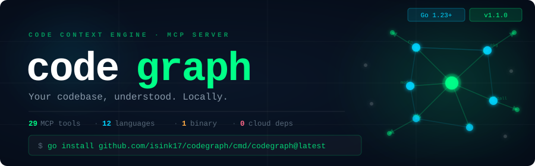

  

  
  
  
  
  

# CodeGraph

CodeGraph is a local-first code context engine and MCP server. It indexes a repository into a local SQLite graph of symbols and source-supported relationships and gives that context to AI coding clients and the CLI, with no hosted backend.

Use it when an assistant needs repository structure, callers and callees, related tests, or task-focused context without rediscovering the codebase from files on every question. CodeGraph helps navigate code; the source stays the authority.

## Install

Build from source (Go 1.26.0 or newer and a C compiler for the tree-sitter CGO bindings):

~~~bash
git clone --depth 1 --branch v2.0 https://github.com/isink17/codegraph.git
cd codegraph
go install ./cmd/codegraph
~~~

Once v2.0.0 is released, [GitHub Releases](https://github.com/isink17/codegraph/releases) will provide verified native archives for Linux, macOS and Windows on amd64 and arm64. The latest published release, v1.2.0, predates v2. See [installation details](docs/README-detailed.md#install).

## Quick start

From the repository you want to work on:

~~~bash
codegraph install   # configure detected MCP clients
codegraph index .   # build the graph
codegraph doctor    # check setup and graph capability
~~~

Restart your client and ask: "Trace the request flow for this feature, then list callers and related tests." The same queries work from the CLI:

~~~bash
codegraph find_callers . NewServer
git diff --name-only | codegraph find_related_tests --stdin
~~~

## Why CodeGraph

- **Evidence over guesses.** A relationship is recorded only when parsed source supports it. Ambiguous or unsupported calls stay unresolved, and answers say when the stored graph cannot back them.
- **Local and incremental.** One binary, one SQLite file per repository, no service to run. `update` reparses only what changed.
- **Context that fits.** Small results by default, with more detail on request: `detail` levels, compact output, token-budgeted task context and bounded pages.
- **Beyond lookup.** Callers, callees, impact, related tests, semantic graph diffs between commits, architectural constraint checks, a fail-closed edit-safety check, graph audit and edge explanations.

## Supported clients

`codegraph install` configures Claude Code, Cursor, Windsurf and Gemini CLI. Codex and any other MCP client work with a short manual entry that `install` prints. The default mode advertises 32 tools; an opt-in gateway mode (`--tool-mode gateway`) advertises four core tools plus a search-and-call pair to keep the tool list small. An [Agent Skill](skills/codegraph/SKILL.md) teaches agents to use the graph well.

## Supported languages

Go, Python, TypeScript, JavaScript, Java, Kotlin, Rust, C#, Ruby, Swift, PHP and C/C++, with conservative support for Dart, Scala, Lua and HCL/Terraform. CGO builds also provide Solidity syntax indexing: declarations and unbound syntax references, with no call resolution; Solidity is unavailable without CGO. Call resolution uses partial static models per language; [language scope models](docs/scope-models.md) list what each resolves and leaves unresolved. Builds without CGO keep call edges only for Go and Python.

## Documentation

- [Detailed reference](docs/README-detailed.md): MCP tools and contracts, database behavior and compatibility, CLI, configuration, architecture, known limitations
- [Changelog](CHANGELOG.md)
- [Language scope models](docs/scope-models.md)
- [Performance baseline](docs/performance.md): measured indexing, update and query timings with reproducible commands
- [Safe to edit](docs/safe-to-edit.md), [constraints](docs/constraints.md), [edge explanations](docs/explain.md), [Git history](docs/git-history.md)

## License

[Functional Source License, Version 1.1, Apache 2.0 Future License](LICENSE) (`FSL-1.1-Apache-2.0`). On the Change Date in `LICENSE` (March 18, 2028) the software becomes available under the Apache License 2.0.
